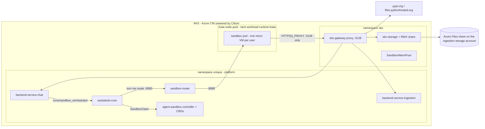
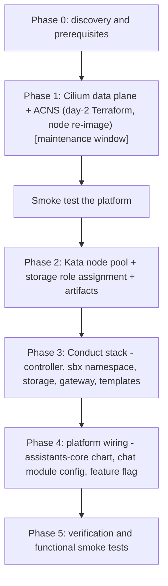

# Rollout guide: Unique AI Conduct on the Hello Azure reference setup

**Status:** validated. Every phase was applied on the reference `test` environment and the verification tests passed.

**Applies to:** an existing Hello Azure installation on platform release `2026.40.5` or later, after the
October 2026 module and provider upgrade (`docs/upgrades/2026-10-infrastructure-upgrade.md`): azurerm 5,
`azure-kubernetes-service` 9.2.0 or later, Argo CD managed applications under `03_applications`.

This is a rollout of a **new capability**, not a migration. It adds resources; no existing service moves.
Unlike the module upgrade, it is not a single `plan`/`apply` per root: it has one disruptive infrastructure
step (the network data plane switch), a new node pool type, five new Argo CD applications, and
configuration changes on two existing applications. The order matters and is given below.

---

## 1. What Conduct adds and why the infrastructure changes

Conduct lets an AI agent execute code, produce files and call tools for a user. Because the agent runs
model-generated code, every user gets a dedicated **micro VM sandbox** (Kata Containers through AKS Pod
Sandboxing) with no platform credentials inside, a **default-deny network policy** enforced by Cilium, and
exactly one way out: an **egress gateway** that allow-lists hosts, paths and methods and injects the user
identity itself. Unique's published requirements are in
[Self-Hosting Conduct](https://unique-ch.atlassian.net/wiki/spaces/PUBDOC/pages/2511962141); sizing in
[Conduct — Sizing & Capacity Planning](https://unique-ch.atlassian.net/wiki/spaces/PUBDOC/pages/2510946345).



Three independent layers constrain a sandbox; none replaces another:

| Layer | Decides | Where it is configured |
|---|---|---|
| Azure network egress (the cluster's outbound path, NSGs, firewall if any) | which external destinations the cluster may reach at all | your network layer; `02_infrastructure/day-1` |
| Cilium network policy (`CiliumNetworkPolicy`) | which pods may talk to which pods and ports; sandbox pods are default-deny in both directions | shipped inside the Conduct charts |
| Conduct egress gateway (`sbx-gateway`) | which host + path + method a request may use, which headers pass, which identity is asserted | `03_applications/<env>/values/conduct/sbx-gateway.yaml` |

Components added by this rollout:

| Component | Where | What it is |
|---|---|---|
| Cilium data plane + Advanced Container Networking Services | AKS cluster (day-2 Terraform) | L7-capable policy engine; replaces the Azure data plane in place |
| Kata node pool | AKS cluster (day-2 Terraform) | Azure Linux nodes with `workload_runtime = KataVmIsolation`, label and taint `workload-runtime=kata`; only sandbox pods schedule there |
| Storage role assignment | day-2 Terraform | lets the Azure Files CSI driver create the checkpoint share on the ingestion storage account |
| `agent-sandbox-controller` 1.0.1 | namespace `unique`, system app (Argo CD) | upstream [kubernetes-sigs/agent-sandbox](https://github.com/kubernetes-sigs/agent-sandbox) controller: 4 CRDs, controller, `sandbox-router` |
| `sbx-common` | cluster scope, `conduct` app set (Argo CD) | the isolated `sbx` namespace for sandbox pods |
| `sbx-storage` + StorageClass `sbx-backup-azurefile` | namespace `sbx` (Argo CD) | checkpoint and skill-cache service, the only pod that mounts the ReadWriteMany share, and the Azure Files class on the ingestion storage account it is provisioned from |
| `sbx-gateway` | namespace `sbx` (Argo CD) | intercepting HTTPS proxy with allow-list; generates its MITM CA (`Secret egress-mitm-ca`) |
| `sbx-templates` (`unique-polyagent-001`) | namespace `sbx` (Argo CD) | `SandboxTemplate` (runtime image, Kata runtime class, security context, network policy) and `SandboxWarmPool` |
| assistants-core on its dedicated chart | namespace `unique` | the generic `ai-service` chart has no sandbox settings; the dedicated `assistants-core` chart carries `sandboxConfig` and the sandbox RBAC |
| Configuration | `chat` backend module config, feature flag | makes the Conduct space type available in the admin UI |

Everything is additive. The Cilium switch is the only step that touches existing nodes.

---

## 2. Prerequisites checklist

Tick every line before you start. Items marked **[manual]** need an action beyond applying this repository's
changes.

### 2.1 Azure subscription and AKS

| # | Requirement | How to check | Notes |
|---|---|---|---|
| 1 | AKS Kubernetes version >= 1.30 | `az aks show -g <core rg> -n <aks> --query currentKubernetesVersion` | the reference cluster runs 1.36 |
| 2 | Azure CNI (any IPAM mode), no Windows node pools, no node auto-provisioning | `az aks show ... --query '{plugin:networkProfile.networkPlugin, dataplane:networkProfile.networkDataplane, policy:networkProfile.networkPolicy, nap:nodeProvisioningProfile.mode}'` | the data plane can be switched to Cilium in place from any Azure CNI mode; NAP clusters cannot be switched (disable NAP first) |
| 3 | Node image versions recorded | `az aks nodepool get-upgrades -g <rg> --cluster-name <aks> -n <pool>` vs `az aks nodepool show ... --query nodeImageVersion` | informational: Microsoft lists no image prerequisite for the data plane switch, and the switch re-images every node. The reference cluster was one image release behind (`202610.03.0` vs `202610.23.0`) and switched without a prior image upgrade |
| 4 | **[manual]** A VM size with nested virtualisation available in your region **and in the zones your pools use** | `az vm list-skus -l <region> --size Standard_D8s_v5 --query "[].{zones:locationInfo[0].zones,restrictions:restrictions}"` | Dsv5/Ddsv5/Dsv6 families work; B-series and v3 sizes without nesting do not |
| 5 | **[manual]** vCPU quota for that family: 8 vCPUs per Kata node you expect to run at the same time, plus one surge node, on top of today's usage | `az vm list-usage -l <region> -o table` (row `standardDSv5Family`) | 2 nodes + surge = 24 vCPUs; the default ceiling of 10 nodes would need 80 |
| 6 | **[manual]** Pod subnet headroom: 48 IPs per Kata node you expect to run at the same time, plus one surge node (`max_pods = 30`) | `kubectl get nnc -n kube-system` and add up the `Allocated IPs` column (phase 0, check 6) | the reference pod subnet is a `/23` (512 addresses) shared with the platform pools; see the sizing note in phase 2 |
| 7 | KEDA add-on enabled | `az aks show ... --query workloadAutoScalerProfile.keda.enabled` | always `true` with the `azure-kubernetes-service` module; only used for optional warm-pool scheduling |

### 2.2 Tooling and access

| # | Requirement | Notes |
|---|---|---|
| 8 | Terraform 1.12.2, azurerm `~> 5.5` | as after the October upgrade |
| 9 | Permission to update the AKS network profile, add node pools and create a role assignment on the ingestion storage account | the identity that applies day-2 |
| 10 | `kubectl` access to the cluster | for verification |
| 11 | Your artifact mirroring process can copy from `uniquecr.azurecr.io` (as for every release) and from `registry.k8s.io` | Conduct adds three images and one Helm chart from Unique plus two public images; the list is in phase 2 |

### 2.3 Network egress from the cluster **[manual]**

| # | Destination | Needed by | Notes |
|---|---|---|---|
| 12 | `ghcr.io`, `pkg-containers.githubusercontent.com` | the four Conduct Helm charts (Argo CD pulls them) | already required for the platform charts |
| 13 | `registry.k8s.io` and its CDN | `agent-sandbox-controller` and `sandbox-router` images | or mirror both images into your registry and override the image repositories |
| 14 | `pypi.org`, `files.pythonhosted.org` on 443 from the **gateway pods** | `pip install` inside sandboxes | optional; disable and point at an internal mirror if the cluster has no internet egress |
| 15 | `api.<your host>` on 443 from the gateway pods | produced files are uploaded through the scoped ingestion endpoint | hairpin through your Application Gateway must work |
| 16 | `<ingestion storage account>.blob.core.windows.net` on 443 from the gateway pods | SAS reads/writes of chat uploads | already allowed for the platform |
| 17 | `<ingestion storage account>.file.core.windows.net` on **TCP 445** from the **AKS nodes** | Azure Files (SMB) checkpoint share | new for Conduct; the node subnet's `Microsoft.Storage` service endpoint covers it on the reference setup |

### 2.4 Storage

| # | Requirement | Notes |
|---|---|---|
| 18 | The ingestion storage account accepts SMB file shares and the node subnet reaches it | the reference account is Standard StorageV2 with public network access on and a service endpoint on the node subnet |
| 19 | 64 GiB of Standard (LRS) Azure Files capacity (the chart default; checkpoints are kept 14 days) | sequential zip read/write only |
| 20 | **[decision]** Shared or dedicated account: the Azure Files CSI driver provisions the share with the **account key**, stored as a Secret in `sbx`, which authorises the whole account. Unique's hosted tenants share the ingestion account. If your policy requires separation, create a dedicated Standard StorageV2 account and point the StorageClass at it | decide before phase 2; changing the account later recreates the share (checkpoints are transient) |

### 2.5 Decisions to take before you start

The reference environment adopts the sizing defaults that Unique runs on its own clusters, so that a
setup derived from this repository behaves like a Unique-operated one. Adjust them only where your
region, quota or network differ; the sizing note in phase 2 explains the trade-offs.

| Decision | Reference default | Where it lands |
|---|---|---|
| Kata VM size | `Standard_D8s_v5` (8 vCPU / 32 GiB, ~6 sandboxes per node) | `kubernetes_kata_node_size` in day-2 |
| Kata pool `min_count` / `max_count` | `0` / `10` (Unique default) | `kubernetes_kata_min_count` / `kubernetes_kata_max_count` in day-2; `min_count = 0` means the first sandbox of the day waits 3–5 minutes for a node boot when the warm pool is empty; `10` is a ceiling, the pod subnet decides how many nodes actually fit (phase 2 sizing note) |
| Kata pool `max_pods` | `30` (Unique default) | `kubernetes_kata_max_pods` in day-2 |
| Kata pool zones | **[manual]** the zones where the VM size is offered in your region, aligned with your other pools | `kubernetes_kata_zones` in day-2; `["1", "3"]` on the reference environment (D8s_v5 is offered in all three zones of swedencentral; the existing pools use 1 and 3) |
| Warm pool size | `2` on the reference environment | `sbx-templates` values; Unique's tenants run 0–6 depending on usage: 2 for a tenant starting out, 4–6 once several users work in parallel. Each warm sandbox holds 0.5–2 vCPU and 4 GiB; 6 of them keep one Kata node permanently allocated |
| Package index access | PyPI through the gateway enabled | `sbx-gateway` values |
| Storage account for checkpoints | the ingestion storage account | StorageClass in the `sbx` application |
| Maintenance window for the Cilium switch | evening or weekend; 1–3 hours; nothing else in flight | your change calendar |

---

## 3. Rollout overview



All phases are delivered in one pull request; the reference environment applied them one at a time, and
each phase section records what that apply or sync looked like. When you pull the final state, your day-2
plan contains phases 1 and 2 together: Terraform performs the data plane switch first and adds the Kata
pool and the storage role assignment after it (the node pool depends on the cluster resource), so one
apply inside one maintenance window is fine. Argo CD then picks up phases 3 and 4 from the repository.
Time budget: phase 1 is 1–3 hours inside a maintenance window (chat keeps working, pods are rescheduled
while nodes re-image); phases 2–4 are 15–20 minutes each; verification 30 minutes.

**Stop means:** do not apply or sync. Save the plan or the Argo CD diff and share it with Unique before you
continue.

---

## Phase 0: discovery and prerequisites

Run the checks in section 2 and record the answers. Set the variables to your names (the values shown are
the reference `test` environment) and run the block after `az login`:

```bash
RG=resource-group-core; AKS=aks-test; VNET_RG=rg-vnet-002; VNET=vnet-001; LOC=swedencentral

# 1. cluster: plugin, IPAM mode, data plane, policy engine, ACNS, version, KEDA, NAP
az aks show -g $RG -n $AKS --query '{plugin:networkProfile.networkPlugin, pluginMode:networkProfile.networkPluginMode, dataplane:networkProfile.networkDataplane, policy:networkProfile.networkPolicy, acns:networkProfile.advancedNetworking, k8s:currentKubernetesVersion, keda:workloadAutoScalerProfile.keda.enabled, nap:nodeProvisioningProfile.mode, osChannel:autoUpgradeProfile.nodeOsUpgradeChannel}' -o json

# 2. node pools: sizes, OS, runtime, image, bounds, zones
az aks nodepool list -g $RG --cluster-name $AKS --query "[].{name:name, vm:vmSize, os:osSku, runtime:workloadRuntime, image:nodeImageVersion, min:minCount, max:maxCount, count:count, maxPods:maxPods, zones:availabilityZones}" -o table

# 3. is every pool on the latest node image? (compare with the image column above)
for p in $(az aks nodepool list -g $RG --cluster-name $AKS --query "[].name" -o tsv); do
  echo "$p latest: $(az aks nodepool get-upgrades -g $RG --cluster-name $AKS -n $p --query latestNodeImageVersion -o tsv)"
done

# 4. Kata VM size: zones and restrictions in your region
az vm list-skus -l $LOC --size Standard_D8s_v5 --query "[].{name:name, zones:locationInfo[0].zones, restrictions:restrictions[].reasonCode}" -o json

# 5. vCPU quota of the family
az vm list-usage -l $LOC -o table | grep -i -E 'DSv5|Total Regional'

# 6. pod subnet usage: pod IPs reserved per node by Azure CNI (sum the "Allocated IPs" column)
kubectl get nnc -n kube-system
```

Do not read the pod subnet usage from the Azure portal or the VNet `usages` API: with dynamic pod IP
allocation they count NIC IP configurations only and report the pod subnet as empty (`0 of 507` on the
reference environment with five nodes running). The node subnet figure from the same API is correct
(one address per node plus the internal load balancer).

Record the output; the decisions in section 2.5 (zones, warm pool) and the stop conditions of phase 1
depend on it.

---

## Phase 1: Cilium data plane and ACNS

**What changes.** In `02_infrastructure/day-2/22-kubernetes.tf` the `network_profile` of the AKS module gains
three attributes, the same values Unique runs on its own clusters:

```hcl
network_profile = {
  network_data_plane          = "cilium"
  network_policy              = "cilium"
  advanced_networking_enabled = true
  idle_timeout_in_minutes     = var.aks_network_profile_idle_timeout_in_minutes
  outbound_ip_address_ids     = [data.azurerm_public_ip.aks_public_ip.id]
}
```

`advanced_networking_enabled` turns on Advanced Container Networking Services (observability and security).
It is a paid AKS add-on, billed per node-hour (USD 0.025 per node-hour at the time of writing, roughly
USD 18 per node and month). The IPAM mode does not change: pods keep their IPs from the pod subnet, so the
Application Gateway ingress controller keeps addressing pods directly.

**Why.** Conduct isolates sandbox pods with `CiliumNetworkPolicy` (default-deny, egress only to the
gateway and DNS). The Cilium data plane is the supported way to get that on AKS; ACNS adds the L7 and
FQDN policy features and Hubble metrics on top.

**Before you plan.** Back up the day-2 state as in the upgrade guide:
`terraform state pull > <backup folder>/day-2-before-conduct.tfstate`.

**Expected plan** (day-2): `0 to add, 1 to change, 0 to destroy`, on
`module.kubernetes_cluster.azurerm_kubernetes_cluster.cluster`, all inside `network_profile`:

```text
~ network_profile {
    ~ network_data_plane  = "azure" -> "cilium"
    + network_policy      = "cilium"          # "azure" -> "cilium" if the cluster ran the Azure Network Policy Manager
    + advanced_networking {
        + observability_enabled = true
        + security_enabled      = true
      }
  }
```

Two more lines appear and are normal: `module.kubernetes_cluster.data.azurerm_monitor_diagnostic_categories.aks[0]
will be read during apply` (the data source depends on the cluster and re-reads whenever the cluster has a
pending change) and the `Value for undeclared variable` warnings for `prometheus-rules.auto.tfvars`, which
predate this rollout.

**Stop if**

- the plan says `must be replaced` or shows `-/+` for the cluster. Provider 5.x upgrades the data plane
  `azure` → `cilium` and the policy engine none/`azure`/`calico` → `cilium` in place; if phase 0 shows
  any other combination, share it with Unique before you plan
- anything outside `network_profile` changes
- the phase 0 output shows Windows node pools or node auto-provisioning (not supported for the switch)

**No way back without a rebuild.** Cilium → Azure is not an in-place transition. Once this phase is
applied, every plan from a revision that lacks the three attributes (an older branch, a hotfix branch
cut from `main` before this change was merged) shows the cluster as `must be replaced`, with the node
pools, diagnostic setting and data collection rule associations behind it. Merge this change before
you branch anything else that touches day-2, and treat `must be replaced` on the cluster as a hard stop
in every later plan.

**Impact.** The apply took 27 minutes on the reference environment (five nodes in two active pools, the
third pool scaled to zero); budget up to an hour for larger clusters. All three attributes go to Azure in
one request, so one apply is enough. Azure re-images every node pool at the same time, rolling
within each pool with its surge setting, like a node image upgrade: pods are drained and rescheduled,
single-replica workloads are unavailable for the seconds to minutes their pod needs to come back, and
the Application Gateway returns 502 for a backend while its pod moves. Run it in a maintenance window.
If the cluster used the Azure Network Policy Manager, Azure uninstalls it; existing `NetworkPolicy`
objects are enforced by Cilium from the moment all nodes are re-imaged. Nothing in Argo CD changes.

**During the apply**, in a second terminal:

```bash
kubectl get nodes -o wide -w                                          # surge nodes join, old nodes drain and leave
kubectl get pods -A --field-selector=status.phase!=Running,status.phase!=Succeeded   # should empty out again within minutes
```

Pods that stay `Pending` for more than ~10 minutes usually mean a PodDisruptionBudget that cannot be
satisfied with the current replica count, or the pod subnet running out of addresses; neither stops the
Azure operation, but fix the cause before the window ends.

**Verify afterwards**

```bash
az aks show -g $RG -n $AKS --query '{dataplane:networkProfile.networkDataplane, policy:networkProfile.networkPolicy, acns:networkProfile.advancedNetworking}' -o json
kubectl -n kube-system get pods -l k8s-app=cilium -o wide
kubectl get crd ciliumnetworkpolicies.cilium.io
kubectl get nodes -o custom-columns=NAME:.metadata.name,IMAGE:.status.nodeInfo.osImage,READY:.status.conditions[-1].type
kubectl get nnc -n kube-system
```

Expected: one `Running` cilium pod per node, the CRD present, every node `Ready` on the new image, and the
`NodeNetworkConfig` objects still listing allocated pod IPs (Cilium changed the data plane, not the IPAM).

Then the smoke test of the platform: log in to the chat, send a message, upload a document. Plan day-2
again: `No changes`.

## Phase 2: Kata node pool, storage access, artifacts

**What changes.**

- `02_infrastructure/day-2/01-variables.tf`: the `kubernetes_kata_*` variables below, plus
  `kubernetes_kata_enabled` (default `true`; `false` skips the pool and the storage role for a cluster
  that does not run Conduct).
- `02_infrastructure/day-2/22-kubernetes.tf`: `kata_node_pool_settings` on the AKS module, one pool named
  `kata`, built from those variables.
- `02_infrastructure/day-2/25-role-assignments.tf`: `Storage Account Contributor` on the ingestion storage
  account for the cluster's control-plane identity (`module.kubernetes_cluster.cluster_resource.identity[0]`).
  The Azure Files CSI driver acts as that identity when it creates the checkpoint share, and the account
  lives outside the node resource group, where the identity has no rights by default.
**Artifacts to mirror** into your registry with your own process, before phase 3 (the reference
environment lists them in `mirroring/test/`):

| Source | Artifact | Version |
|---|---|---|
| `uniquecr.azurecr.io` | images `unique/sbx-gateway`, `unique/sbx-storage`, `unique/unique-polyagent-001` | the chat release version (`2026.44.3` on the reference environment) |
| `uniquecr.azurecr.io` | Helm chart `helm/assistants-core` | same |
| `registry.k8s.io` | images `agent-sandbox/agent-sandbox-controller`, `agent-sandbox/sandbox-router-go` | `v1.0.1` (the chart's `appVersion`) |
| `ghcr.io/unique-ag/helm-charts` | charts `agent-sandbox-controller` 1.0.1, `sbx-gateway`, `sbx-storage`, `sbx-templates` 2026.44.3 | pulled by Argo CD directly, like the platform charts; mirror them only if your Argo CD has no access to `ghcr.io` |

The controller chart pins its two images by upstream digest; the values in this repository clear those
pins and reference the images by tag, so a mirror that rewrites digests works as well.

### Kata pool defaults adopted from Unique's clusters

The Kata pool is configured through day-2 variables with the same names and defaults that Unique uses on
its own clusters. Override them in `tfvars` only where your environment differs.

| Variable | Default | Why |
|---|---|---|
| `kubernetes_kata_node_size` | `Standard_D8s_v5` | nested virtualisation; 8 vCPU / 32 GiB fits ~6 sandboxes |
| `kubernetes_kata_min_count` | `0` | the pool scales to zero when the warm pool is empty and nobody works |
| `kubernetes_kata_max_count` | `10` | autoscaler ceiling; see the sizing note below |
| `kubernetes_kata_max_pods` | `30` | one sandbox per pod; also bounds the pod IPs a node reserves |
| `kubernetes_kata_zones` | **[manual]** per region, `["1", "3"]` on the reference environment | the VM size is not offered in every zone of every region; align with your other pools |
| `kubernetes_kata_max_surge` | `30%` | upgrades replace at most a third of the pool at a time |
| `kubernetes_kata_drain_timeout_in_minutes` | `30` | Kata VMs stop slowly and sandbox pods run with `restartPolicy: Never` |
| `kubernetes_kata_undrainable_node_behavior` | `Cordon` | one stuck sandbox pod must not fail the whole AKS upgrade |

The module adds the label `workload-runtime=kata`, the taint `workload-runtime=kata:NoSchedule`, Azure
Linux and `workload_runtime = KataVmIsolation` on its own.

### Sizing note: pod subnet and Kata pool `max_count`

`max_count = 10` is the autoscaler ceiling, not a sizing target. Unique's busiest clusters, on the same
`/23` pod subnet layout, run at 2 Kata nodes (a warm pool of 6 plus active sessions) and briefly reach 3
during upgrades; the ceiling has never been approached. What actually limits the pool is the pod subnet:

- Azure CNI with a pod subnet hands pod IPs to nodes in batches of 16 and keeps one spare batch per node.
  A Kata node with `max_pods = 30` holds at most 48 pod IPs; one that only carries the warm pool typically
  holds 32.
- The reference pod subnet is a `/23`: 507 usable addresses, shared with the platform pools (default 2–5,
  rapid 0–3, steady 0–4 nodes). Measured on the reference environment: 176 IPs reserved by five nodes
  (32 / 32 / 48 / 48 / 16), and 400–570 would be needed if every pool scaled out at once. With the
  platform at its normal load, 2–3 Kata nodes fit comfortably; beyond that the Kata pool and the platform
  pools compete for the same addresses.
- The autoscaler does not know about the subnet. When it runs out, new nodes still join the cluster but
  their pods stay in `ContainerCreating` without an IP. Use the `used` figure from phase 0 and your
  platform pools' real peak, not the nominal maxima, to know where that point is.
- If you expect to run more than 2–3 Kata nodes, give the pool its own pod subnet rather than lowering
  `max_count`: `kata_node_pool_settings.<pool>.subnet_pods_id` (and optionally `subnet_nodes_id`) accept
  a different subnet. Add a `/23` or `/22` with the `Microsoft.ContainerService/managedClusters`
  delegation in day-1 and reference it from day-2; the existing pools are not touched.

### Plan, apply, verify

**Expected plan** (day-2): `2 to add, 0 to change, 0 to destroy`:

- `+ module.kubernetes_cluster.azurerm_kubernetes_cluster_node_pool.kata_node_pool["kata"]` with
  `workload_runtime = "KataVmIsolation"`, `os_sku = "AzureLinux"`, `max_pods = 30`, `min_count = 0`,
  `max_count = 10`, label `workload-runtime = kata`, taint `workload-runtime=kata:NoSchedule`
- `+ azurerm_role_assignment.ingestion_storage_aks_file_shares[0]`

**Stop if** anything changes on `azurerm_kubernetes_cluster.cluster` itself, or on the existing node pools.

**Impact.** None on running workloads: a new pool with `min_count = 0` creates no VM until a sandbox pod
is scheduled, and the role assignment is additive. The apply takes 3–5 minutes.

**Verify**

```bash
az aks nodepool show -g $RG --cluster-name $AKS -n kata --query '{runtime:workloadRuntime, os:osSku, vm:vmSize, min:minCount, max:maxCount, maxPods:maxPods, taints:nodeTaints}' -o json
az role assignment list --scope $(az storage account show -n <ingestion account> -g <sensitive rg> --query id -o tsv) --query "[?roleDefinitionName=='Storage Account Contributor'].principalId" -o tsv   # the cluster identity
az acr repository show-tags -n <acr> --repository unique/sbx-gateway -o tsv                                 # or your registry's equivalent: all artifacts of the table above present
kubectl get runtimeclass kata-vm-isolation                                                                  # appears with the first Kata node; absent until then is fine
```

## Phase 3: Conduct stack

Four Argo CD applications in a new `conduct` application set (destination namespace `sbx`) plus the
controller as a system application. Nothing here touches the running platform; the stack is inert until
assistants-core is pointed at it in phase 4.

**What changes.**

| File | Purpose |
|---|---|
| `03_applications/<env>/values/argo/argo-appsets.yaml` | new `conduct` application set reading `03_applications/<env>/apps/conduct/*.yaml`, destination namespace `sbx` |
| `03_applications/<env>/apps/system/agent-sandbox-controller.yaml` + `values/agent-sandbox-controller/` | chart `agent-sandbox-controller` 1.0.1 from `ghcr.io/unique-ag/helm-charts`, images from your registry mirror, `ServerSideApply=true` for the large CRDs, router NetworkPolicy: ingress from `assistants-core` in `unique` only, egress to `sbx` only |
| `apps/conduct/sbx-common.yaml` + `values/conduct/sbx-common.yaml` | `Namespace sbx` (never pruned); the counterpart of `sbx-common` on Unique's clusters |
| `apps/conduct/sbx-storage.yaml` + `values/conduct/sbx-storage.yaml`, `values/conduct/sbx-storage-storageclass.yaml` | chart `sbx-storage` 2026.44.3 plus the `StorageClass sbx-backup-azurefile` it needs (`file.csi.azure.com`, Standard_LRS, your ingestion storage account and its resource group, uid/gid 65534); PVC `ReadWriteMany` on that class, chart default 64 GiB |
| `apps/conduct/sbx-gateway.yaml` + `values/conduct/sbx-gateway.yaml` | chart `sbx-gateway` 2026.44.3; `internalServices.dependencies.chat/ingestion` point at `backend-service-chat` / `backend-service-ingestion` in `unique` (Service port 80); allow-list for your public API host, your ingestion blob host, `sbx-storage`, PyPI; `ignoreDifferences` + `RespectIgnoreDifferences` on the generated MITM CA Secret |
| `apps/conduct/sbx-templates.yaml` + `values/conduct/sbx-templates-unique-polyagent-001.yaml` | chart `sbx-templates` 2026.44.3; runtime image from your mirror, platform URLs of this repository, warm pool `2`, CiliumNetworkPolicy ingress from the router in `unique`, Prometheus/Grafana extras off |

**[manual] Adapt before you sync:** registry name, public API hostname, ingestion storage account name and
resource group (StorageClass and gateway allow-list), warm pool size. The blob path filter
`/ingestion/*/cont_*` assumes the ingestion container is named `ingestion`, as created by this repository.

**Sync order** (all applications are `autoSync: false`; sync by hand in this order and wait for Healthy):

1. `argo` (picks up the new application set; the four `conduct` applications appear)
2. `agent-sandbox-controller`: CRDs, controller, router. Expect `kubectl get crd | grep x-k8s.io` to list
   `sandboxes.agents.x-k8s.io`, `sandboxclaims`, `sandboxtemplates`, `sandboxwarmpools.extensions.agents.x-k8s.io`
3. `sbx-common`: the `sbx` namespace
4. `sbx-storage`: StorageClass, service and PVC; the PVC must reach `Bound` within a minute. `Pending` with `AuthorizationFailed` on
   `listKeys` in the PVC events means the phase 2 role assignment is missing or not yet propagated; a
   mount error on the pod means TCP 445 to the storage account is blocked
5. `sbx-gateway`: 2 replicas `Running`, Secret `egress-mitm-ca` created
6. `sbx-templates-unique-polyagent-001`: `SandboxTemplate` and `SandboxWarmPool` created. The warm pool
   asks for 2 sandboxes, which schedules 2 Kata pods: the autoscaler adds the first Kata node (3–5 min),
   then the pods pull the runtime image (several GiB, a few more minutes) and go `Running`

**Stop if** a chart fails to render in Argo CD (missing Cilium CRDs means phase 1 is not complete), the
PVC stays `Pending` for more than 5 minutes after the role assignment propagated, or the warm pool pods
stay `Pending` for more than 10 minutes with `0/N nodes available` (Kata pool `max_count`, quota or pod
subnet; see phase 2).

**Verify**

```bash
kubectl get crd | grep x-k8s.io                                           # 4 CRDs
kubectl -n unique get pods -l app.kubernetes.io/name=agent-sandbox-controller   # controller + 2 router pods Running
kubectl -n unique get pods -l app=sandbox-router                          # the same 2 router pods: this is the label the sandbox CiliumNetworkPolicy admits
kubectl -n sbx get pvc,pods                                               # PVC Bound; sbx-storage, 2x sbx-gateway, 2 warm sandbox pods Running
kubectl -n sbx get sandboxtemplates,sandboxwarmpools,sandboxes            # template, pool (2/2 ready), 2 sandboxes
kubectl get nodes -l workload-runtime=kata                                # 1 Kata node
kubectl -n sbx get cnp                                                    # policies for sandbox pods and sbx-storage
```

**Expect probe noise on new sandbox pods.** The runtime opens port 8888 about 10–15 seconds after the
container starts (agent stack import, bundled-skills cache); until then the readiness probe reports
`connection refused`. A pod that is `1/1 Running` a minute after scheduling is healthy. A pod that stays
`0/1` for several minutes is not: read its log, it ends in retries against the gateway or `sbx-storage`.

## Phase 4: Platform wiring

**What changes.**

| File | Purpose |
|---|---|
| `03_applications/<env>/apps/chat/assistants-core.yaml` | chart switched from `ai-service` (`ghcr.io/unique-ag/helm-charts`) to the dedicated `assistants-core` chart from your registry (`<registry>/helm`, same version as the chat release); same release name and selector labels, so the Deployment rolls in place |
| `03_applications/defaults/ai-services/assistants-core.yaml` | rewritten for the dedicated chart's schema: `internalServices.dependencies` for `backend-service-chat` (port 80) and `backend-service-configuration` (8095), the few env values the chart does not default, `nodeSelector`, workload identity on |
| `03_applications/<env>/values/ai-services/assistants-core.yaml` | image from your mirror, environment env values, `secretProvider` (tenant, CSI identity, vault), `workloadIdentity.azure.clientId`, and `sandboxConfig`: `namespace: sbx`, `template: unique-polyagent-001`, router `agent-sandbox-controller-router-svc` in `unique`, port 8080 |
| `03_applications/defaults/backend-services/chat.yaml`, `03_applications/<env>/values/backend-services/chat.yaml` | `INTERNAL_MODULES_CONFIG` gains `{"name": "SwappableIntelligence", "apiURL": "http://assistants-core.unique.svc.cluster.local:8081/core/sandbox_orchestrator"}` (both files carry the full list) |
| `03_applications/<env>/values/_flags.yaml` | `FEATURE_FLAG_ENABLE_SWAPPABLE_INTELLIGENCE_UN_18404: "true"` (`FEATURE_FLAG_ENABLE_SKILLS_UN_20042` must be `"true"` as well) |

With `sandboxConfig.enabled`, the chart renders `SANDBOX_NAMESPACE`, `SANDBOX_TEMPLATE`,
`SANDBOX_ROUTER_URL`, `SANDBOX_CLAIM_TTL_SECONDS` on the pod and a Role/RoleBinding **in namespace
`sbx`** for the assistants-core service account (create/patch/delete `sandboxclaims`, read templates,
pools and sandboxes). That is why phase 3 comes first.

**Sync order:** `assistants-core` (rolling update, `maxUnavailable: 0`), then `backend-service-chat`
(rolling restart for the new module list), then `backend-service-configuration` and `reflector`, the two
applications that load `_flags.yaml`. Chat stays available throughout; a Conduct space can be created in
the admin UI once the flag is live.

**Stop if** the assistants-core diff shows the Deployment as delete+create instead of an update (selector
mismatch; share the diff), or pods crash-loop on start (secret provider or env; compare the rendered
ConfigMap with the previous one).

**Verify**

```bash
kubectl -n unique get deploy assistants-core -o jsonpath='{.spec.template.spec.containers[0].image}{"\n"}'
kubectl -n unique exec deploy/assistants-core -- env | grep SANDBOX_
kubectl -n sbx get role,rolebinding | grep assistants-core
kubectl -n unique exec deploy/backend-service-chat -- env | grep -c SwappableIntelligence   # 1
```

The pod environment also shows a set of `AGENT_SANDBOX_CONTROLLER_*` variables: Kubernetes service links
for the router Services in the same namespace, not configuration.

## Phase 5: Verification

Functional checks from a user's point of view, with the matching cluster-side evidence. Run them once
the warm pool shows `2/2` ready.

| # | Test | Expected |
|---|---|---|
| T1 | Admin UI: create a space of type Conduct (Swappable Intelligence) | the type is offered (flag live) and the space saves |
| T2 | Chat: open the space, send a first message | an answer within ~10 s; `kubectl -n sbx get sandboxclaims` shows one claim bound to a warm sandbox and the pool starts a replacement |
| T3 | Chat: ask the agent to read a document from the knowledge base and to produce a file (e.g. a `.docx`) | the file appears in the chat; the gateway's stdout (`kubectl -n sbx logs deploy/sbx-gateway`) shows a `Streaming request to <your API host>` (the upload) and one to `sbx-storage`; the audit log shows the allowed `PUT /scoped/ingestion/upload` |
| T4 | Chat: ask the agent to `pip install` a small package | succeeds (PyPI allow-listed); the audit log shows `GET pypi.org/simple/...` |
| T5 | Chat: ask the agent to fetch `https://example.com` | denied; the audit log shows the blocked host (allow-list working) |

The per-request allow/deny decisions are in the gateway's audit log inside the pod, not on stdout:
`kubectl -n sbx exec deploy/sbx-gateway -- tail -n 30 /var/log/egress-gateway/audit.jsonl` (two replicas;
check the other one if the request is not there).
| T6 | End the session: delete its claim (`kubectl -n sbx delete sandboxclaim <name>`; in daily use this happens after the claim TTL) | `kubectl -n sbx get sandboxclaims,sandboxes` shows the claim and its sandbox gone and the pool back at `replicas` free sandboxes |
| T7 | Leave the cluster idle | warm pool stays at 2; the Kata node count stays at 1; with the warm pool at 0 the Kata pool scales to 0 within ~10 minutes |

Also confirm the platform smoke test from phase 1 still passes (chat, upload, knowledge search).

---

## References

- Self-Hosting Conduct (requirements): https://unique-ch.atlassian.net/wiki/spaces/PUBDOC/pages/2511962141
- Conduct — Sizing & Capacity Planning: https://unique-ch.atlassian.net/wiki/spaces/PUBDOC/pages/2510946345
- Conduct Infrastructure (architecture for security reviews): https://unique-ch.atlassian.net/wiki/spaces/sdv2/pages/2512027669
- Azure CNI powered by Cilium, in-place data plane update: https://learn.microsoft.com/en-us/azure/aks/upgrade-azure-cni
- AKS Pod Sandboxing (Kata): https://learn.microsoft.com/en-us/azure/aks/use-pod-sandboxing
- Advanced Container Networking Services: https://learn.microsoft.com/en-us/azure/aks/advanced-container-networking-services-overview
- kubernetes-sigs/agent-sandbox: https://github.com/kubernetes-sigs/agent-sandbox
